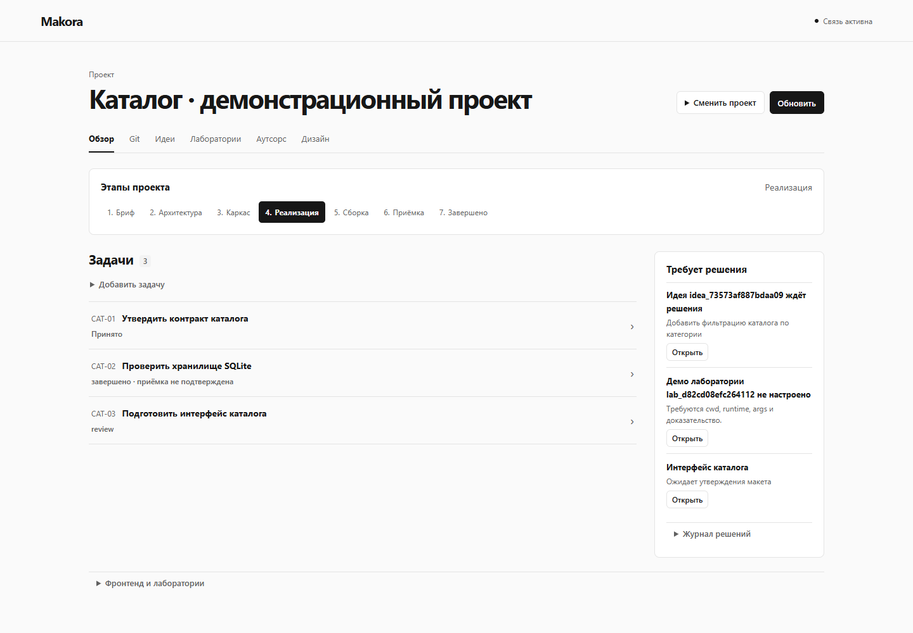
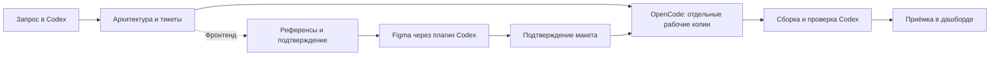
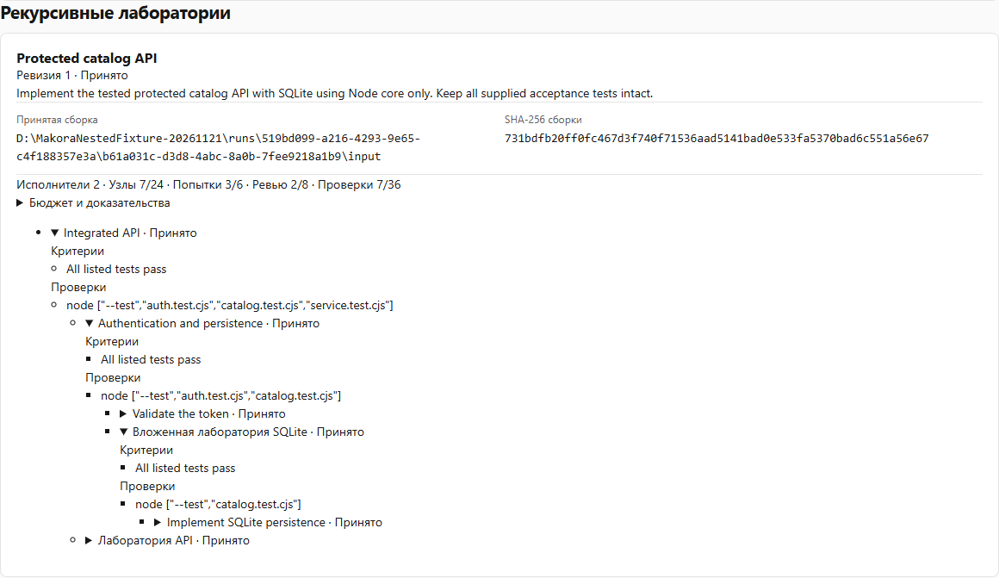
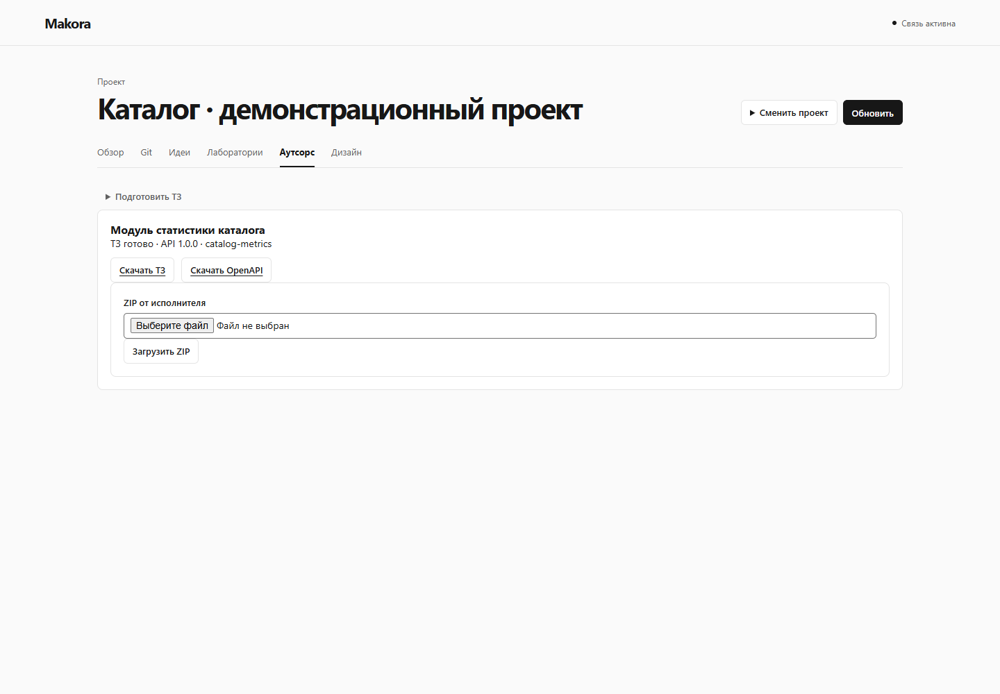
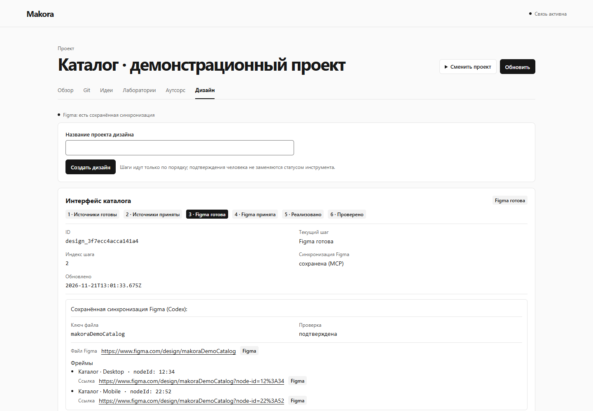

<p align="center"><strong>CODEX × OPENCODE × FIGMA</strong></p>

<h1 align="center">Makora 2.0</h1>

<p align="center">Локальный дашборд для разработки с Codex и OpenCode на Windows. Вложенные лаборатории, проверяемые сборки и ревью из текущего чата.</p>

<p align="center">
  <a href="https://github.com/artemnoor/makora-2.0/releases"></a>
  <a href="https://github.com/artemnoor/makora-2.0/actions/workflows/ci.yml"></a>
  
  
</p>

<p align="center">
  <a href="#быстрый-старт">Быстрый старт</a> ·
  <a href="#как-идёт-задача">Как идёт задача</a> ·
  <a href="#вложенные-лаборатории">Вложенные лаборатории</a> ·
  <a href="#аутсорс-модулей">Аутсорс</a> ·
  <a href="#бэкенд">Бэкенд</a> ·
  <a href="#figma">Figma</a> ·
  <a href="CHANGELOG.md">История версий</a>
</p>



*Снимок работающей панели Makora в Chromium с демонстрационным проектом.*

| Участник | Что делает |
| --- | --- |
| **Codex** | Проектирует архитектуру, ставит задачи и принимает изменения после ревью и тестов. |
| **Makora** | Хранит состояние в SQLite, ведёт очередь, собирает проверенные результаты и сохраняет решения. |
| **OpenCode Desktop** | Пишет код и тесты. Независимые исполнители работают в отдельных Git worktrees или рабочих копиях. |
| **Ты** | Следишь за этапами, принимаешь идеи, открываешь лаборатории и согласовываешь дизайн. |

## Быстрый старт

Нужны Windows, Node.js 22.13 или новее и Git. Для запуска исполнителей установи OpenCode Desktop и войди в него. Для работы с макетами подключи официальный плагин Figma в Codex и используй файл, к которому у тебя есть доступ.

```powershell
git clone https://github.com/artemnoor/makora-2.0.git
Set-Location makora-2.0
npm ci --ignore-scripts
$env:DASHBOARD_DATA_DIR = Join-Path $env:LOCALAPPDATA "Codex/OpenCode Dashboard"
node dashboard/server.cjs
```

Открой [локальный дашборд](http://127.0.0.1:18741/), затем папку своего проекта в Codex. Пример запроса:

> Реализуй [задача] через Makora и E Verified Batch. Веди прогресс в локальном дашборде. Подготовь архитектуру и передай весь код OpenCode. Независимые задачи разнеси по worktrees. Сам проверь изменения, сборку и критерии. Если нужен дизайн, работай через подключённый плагин Figma.

Инструкция Codex должна указывать на [регламент](ORCHESTRATION.md) и [руководство по дашборду](dashboard/README.md) из этого клона. Makora слушает loopback и хранит состояние в локальной SQLite.

## Бэкенд

Makora запускается как локальное Node.js-приложение. HTTP-сервер отдаёт браузерный интерфейс и API. Состояние проектов, задачи и решения хранятся в SQLite.

| Файл | Назначение |
| --- | --- |
| [`dashboard/server.cjs`](dashboard/server.cjs) | HTTP-сервер, статические файлы и маршруты `GET /api/state`, `POST /api/actions`. |
| [`dashboard/store.cjs`](dashboard/store.cjs) | SQLite, правила изменения состояния и журнал решений. |
| [`dashboard/labs.cjs`](dashboard/labs.cjs) и [`dashboard/observer.cjs`](dashboard/observer.cjs) | Запуск лабораторных демо и чтение данных о прогонах OpenCode. |
| [`dashboard/outsource.cjs`](dashboard/outsource.cjs) и [`dashboard/outsource-archive.cjs`](dashboard/outsource-archive.cjs) | Подготовка задания, проверка полученного архива и интеграция принятого модуля. |
| [`dashboard/recursive/`](dashboard/recursive/) | Ревизии планов, зависимости, исполнительские попытки, композиция артефактов и ревью из чата. |
| [`dashboard/web/`](dashboard/web/) | HTML, CSS и JavaScript интерфейса. |

## Как идёт задача



- **Git и сессии.** Видны пути рабочих копий, SHA, ID сессий и результаты E Verified Batch. Приёмка Codex сохраняется отдельно от завершения сессии OpenCode.
- **Демо-лаборатории.** Согласуй рискованный сценарий, открой изолированное демо на отдельном порту и зафиксируй решение.
- **Вложенные лаборатории.** Утверди дерево работ. Makora запускает готовые листья, проверяет ветви и сохраняет решения текущего чата.
- **Аутсорс.** Скачай ТЗ и OpenAPI для внешнего исполнителя, прими ZIP после ревью и добавь файлы в отдельный каталог проекта. [Руководство по аутсорсу](dashboard/README.md#аутсорс)
- **Идеи.** Отправь из чата Codex «Добавь идею в проект …». Codex сохранит исходный текст и предложит, когда к нему вернуться.
- **Профили моделей.** Промпт подстраивается под модель, а контракт, границы записи и критерии тикета сохраняются. [Навык создания профилей](skills/model-prompt-profile/SKILL.md)

## Вложенные лаборатории

Текущий чат Codex формирует дерево работ и определяет зависимости. Пользователь утверждает конкретную ревизию в панели. Makora выдаёт готовые листья в E Verified Batch и собирает ветви по мере готовности. Принятый результат открывает зависимые работы. Независимые листья могут выполняться, пока другая ветвь ждёт ревью. Запросы привязаны к ID и хешам сборки и проверки и сохраняются после перезапуска.



*Снимок панели после прогона дерева из четырёх уровней с тестовым исполнителем и реальными проверками Node.js и SQLite.*

Режим включается отдельной локальной конфигурацией. Порядок утверждения, запуск OpenCode Desktop 2.3.0 и известные пограничные случаи описаны в руководстве. [Настройка рекурсивного режима](docs/recursive-labs.md) · [Что проверено в пилоте](docs/makora-vault/11%20%E2%80%94%20%D0%9F%D0%B8%D0%BB%D0%BE%D1%82%20%D0%B8%20%D0%B3%D1%80%D0%B0%D0%BD%D0%B8%D1%86%D1%8B%20%D0%BF%D1%80%D0%BE%D0%B2%D0%B5%D1%80%D0%BA%D0%B8.md)

## Аутсорс модулей

Makora готовит переносимое ТЗ с OpenAPI. Внешний исполнитель возвращает ZIP, который сначала попадает в отдельную папку для ревью. После проверки архива и подтверждения SHA-256 файлы можно перенести в новый каталог проекта.



*Снимок вкладки «Аутсорс» с демонстрационным ТЗ.*

## Figma

Codex открывает и редактирует разрешённый макет через официальный плагин Figma. После чтения файла он сохраняет ключ и ссылки на фреймы в карточке дизайна. Пользователь подтверждает референсы перед работой в Figma и утверждает макет перед передачей в вёрстку.



*Снимок карточки дизайна в Makora. Ссылки и ID фреймов на снимке демонстрационные.*

## Документация

- [База знаний Makora для Obsidian](docs/makora-vault/00%20%E2%80%94%20Makora.md) — карта системы и связанные заметки по ролям, лабораториям, сборке, дашборду и эксплуатации.

| Что нужно | Где посмотреть |
| --- | --- |
| Запуск, идеи, лаборатории и плагин Figma | [Руководство по дашборду](dashboard/README.md) |
| Архитектура, тикеты, worktrees, сборка и ревью | [Регламент E Verified Batch](ORCHESTRATION.md) |
| Готовые профили и источники | [Реестр профилей](dashboard/profiles/README.md) · [Источники](dashboard/profiles/SOURCES.md) |
| Изменения по версиям | [История версий](CHANGELOG.md) · [Релизы GitHub](https://github.com/artemnoor/makora-2.0/releases) |

Для проверок из корня клона запусти:

```powershell
npm test
```

GitHub Actions выполняет тот же набор на Windows с Node.js 22. [Проверки CI](https://github.com/artemnoor/makora-2.0/actions/workflows/ci.yml)
