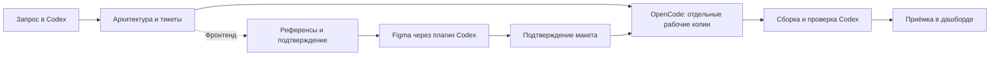

<p align="center"><strong>CODEX × OPENCODE × FIGMA</strong></p>

<h1 align="center">Makora 2.0</h1>

<p align="center">Локальный дашборд для разработки с Codex и изолированными субагентами OpenCode на Windows.</p>

<p align="center">
  <a href="https://github.com/artemnoor/makora-2.0/releases"></a>
  
  
</p>

<p align="center">
  <a href="#быстрый-старт">Быстрый старт</a> ·
  <a href="#как-идёт-задача">Как идёт задача</a> ·
  <a href="#бэкенд">Бэкенд</a> ·
  <a href="#figma">Figma</a> ·
  <a href="CHANGELOG.md">История версий</a>
</p>


*Светлый обзор на демонстрационных данных. Этапы, задачи и ожидающие решения видны на одном экране.*

| Участник | Что делает |
| --- | --- |
| **Codex** | Проектирует архитектуру, ставит задачи и принимает изменения после ревью и тестов. |
| **OpenCode Desktop** | Пишет код и тесты. Независимые исполнители работают в отдельных Git worktrees или рабочих копиях. |
| **Ты** | Следишь за этапами, принимаешь идеи, открываешь лаборатории и согласовываешь дизайн. |

## Быстрый старт

Нужны Windows, Node.js 22.13 или новее и Git. Для запуска исполнителей установи OpenCode Desktop и войди в него. Для работы с макетами подключи официальный плагин Figma в Codex и используй файл, к которому у тебя есть доступ.

```powershell
git clone https://github.com/artemnoor/makora-2.0.git
Set-Location makora-2.0
npm ci --ignore-scripts
$env:DASHBOARD_DATA_DIR = Join-Path $env:LOCALAPPDATA "Codex/OpenCode Dashboard"
node dashboard/server.cjs
```

Открой [локальный дашборд](http://127.0.0.1:18741/). Затем открой папку своего проекта в Codex и отправь задачу:

> Реализуй [задача] через Makora и E Verified Batch. Веди прогресс в локальном дашборде. Подготовь архитектуру и передай весь код OpenCode. Независимые задачи разнеси по worktrees. Сам проверь изменения, сборку и критерии. Если нужен дизайн, работай через подключённый плагин Figma.

Инструкция Codex должна указывать на [регламент](ORCHESTRATION.md) и [руководство по дашборду](dashboard/README.md) из этого клона. Makora слушает loopback и хранит состояние в локальной SQLite.

## Бэкенд

Makora запускается как локальное Node.js-приложение. HTTP-сервер отдаёт браузерный интерфейс и API. Состояние проектов, задачи и решения хранятся в SQLite.

| Файл | Назначение |
| --- | --- |
| [`dashboard/server.cjs`](dashboard/server.cjs) | HTTP-сервер, статические файлы и маршруты `GET /api/state`, `POST /api/actions`. |
| [`dashboard/store.cjs`](dashboard/store.cjs) | SQLite, правила изменения состояния и журнал решений. |
| [`dashboard/labs.cjs`](dashboard/labs.cjs) и [`dashboard/observer.cjs`](dashboard/observer.cjs) | Запуск лабораторных демо и чтение данных о прогонах OpenCode. |
| [`dashboard/outsource.cjs`](dashboard/outsource.cjs) и [`dashboard/outsource-archive.cjs`](dashboard/outsource-archive.cjs) | Подготовка задания, проверка полученного архива и интеграция принятого модуля. |
| [`dashboard/web/`](dashboard/web/) | HTML, CSS и JavaScript интерфейса. |

## Как идёт задача



- **Git и сессии.** Видны пути рабочих копий, SHA, ID сессий и результаты E Verified Batch. Приёмка Codex сохраняется отдельно от завершения сессии OpenCode.
- **Лаборатории.** Согласуй рискованный сценарий, открой изолированное демо на отдельном порту и зафиксируй решение.
- **Аутсорс.** Скачайте ТЗ и OpenAPI для внешней модели, примите ZIP после ревью и добавьте файлы в отдельный каталог проекта. [Руководство по аутсорсу](dashboard/README.md#аутсорс)
- **Идеи.** Отправь из чата Codex «Добавь идею в проект …». Codex сохранит исходный текст и предложит, когда к нему вернуться.
- **Профили моделей.** Промпт подстраивается под модель, а контракт, границы записи и критерии тикета сохраняются. [Навык создания профилей](skills/model-prompt-profile/SKILL.md)

## Figma

Codex открывает и редактирует разрешённый макет через официальный плагин Figma. После чтения файла он сохраняет ключ и ссылки на фреймы в карточке дизайна. Пользователь подтверждает референсы перед работой в Figma и утверждает макет перед передачей в вёрстку.


*Демонстрационный макет. Ссылки и ID на снимке служат примерами.*

## Документация

| Что нужно | Где посмотреть |
| --- | --- |
| Запуск, идеи, лаборатории и плагин Figma | [Руководство по дашборду](dashboard/README.md) |
| Архитектура, тикеты, worktrees, сборка и ревью | [Регламент E Verified Batch](ORCHESTRATION.md) |
| Готовые профили и источники | [Реестр профилей](dashboard/profiles/README.md) · [Источники](dashboard/profiles/SOURCES.md) |
| Изменения по версиям | [История версий](CHANGELOG.md) · [Релизы GitHub](https://github.com/artemnoor/makora-2.0/releases) |

Проверки из корня клона:

```powershell
node --test workers.scope.test.cjs workers.verified.test.cjs dashboard/core.test.cjs dashboard/adapters.test.cjs dashboard/outsource.test.cjs
```
