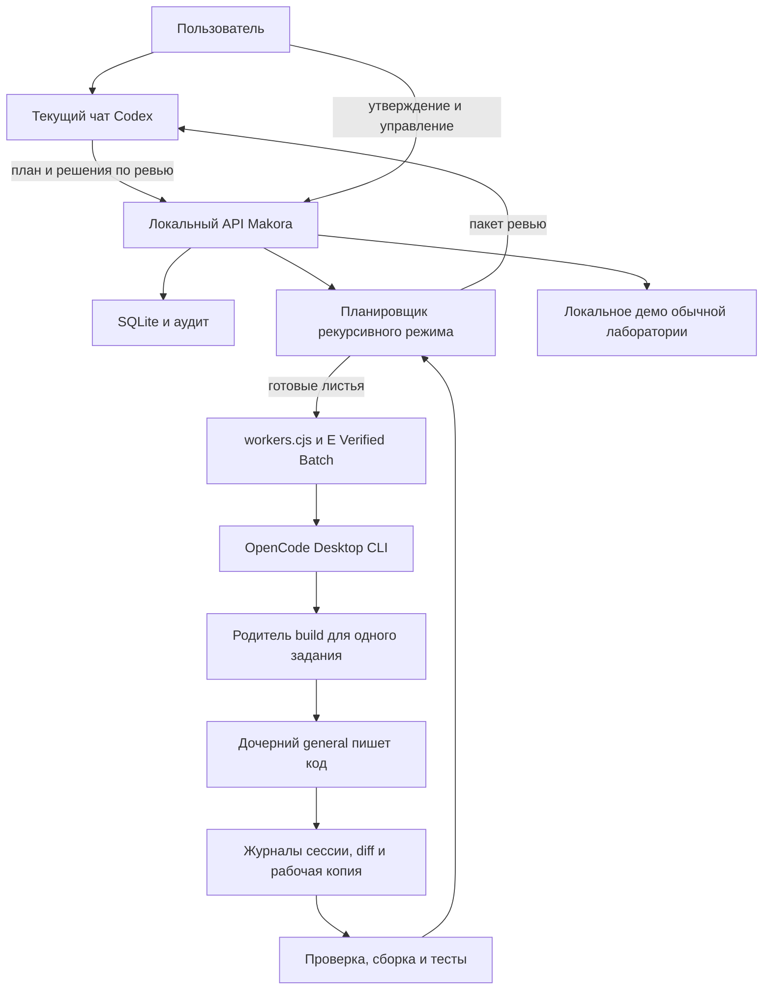

# Архитектура и роли

[[00 — Makora]] · [[02 — Проекты и задачи]] · [[04 — Вложенные лаборатории]] · [[05 — E Verified Batch]]

## Кто и за что отвечает

| Участник | Ответственность |
|---|---|
| Пользователь | Формулирует задачу и определяет допустимые полномочия. Подтверждает ревизию плана, решения по идеям, демо и дизайн в панели. |
| Текущий чат Codex | Понимает задачу, определяет архитектуру и контракты, декомпозирует работы, формирует тикеты, проверяет результаты и публикует решения по ревью. |
| Дашборд Makora | Показывает состояние и принимает локальные команды. Сервер проверяет переходы, хранит состояние в SQLite и управляет локальными демо. |
| Рекурсивный планировщик | Превращает утверждённое дерево в очередь готовых работ. Запускает исполнительские батчи и проверки ветвей, связывает результаты и зависимости, ждёт ответа из текущего чата. |
| Родительская сессия OpenCode `build` | Получает задание одного исполнителя и поручает его указанному дочернему агенту, обычно `general`. Родителю поручено следить за отчётом. |
| Дочерняя сессия OpenCode `general` | Пишет файлы по одному тикету в своей рабочей копии и сообщает результат. Makora проверяет его по журналам, экспорту сессии и изменениям файлов. |
| Сборщик и тесты | Проверяют состав правок и хеши, собирают копию из допустимых изменений, выполняют проверки с зафиксированными аргументами. Это операции кода Makora. |

## Кто кого вызывает

В ручном режиме чат может сам запустить `workers.cjs batch` и провести его приёмку. В рекурсивном режиме батч вызывает планировщик. Оба пути используют механизмы E Verified Batch, но только рекурсивный режим строит историю узлов и сам выдаёт готовые листья по зависимостям.

### Сколько агентов

Два листа в одном батче означают два независимых задания. Для каждого ожидается одна родительская и одна дочерняя сессия. Если провайдер отклоняет запрос на первом шаге, дочерняя сессия может вообще не появиться. У ветки нет собственной исполнительской сессии: за неё отвечают композиция артефактов, интеграционные проверки и ревью из чата.

Пользовательское дерево и иерархия OpenCode — разные структуры. Дерево Makora описывает работы и зависимости. Связь `build → general` относится к выполнению одного листа. Дополнительный Codex для планирования и приёмки в текущей архитектуре не запускается.

## Границы компонентов

- `dashboard/server.cjs` обслуживает UI и локальный API. `dashboard/store.cjs` отвечает за основные сущности и аудит. `dashboard/web/` отображает состояние и отправляет действия.
- `dashboard/labs.cjs` управляет процессами обычных демо. `dashboard/observer.cjs` читает существующие отчёты прогонов и Git-метаданные.
- `dashboard/recursive/plan.cjs` нормализует и валидирует планы. `repository.cjs` хранит версии и события исполнения. `scheduler.cjs` определяет готовность. `runtime.cjs` связывает операции и принимает ревью из чата.
- `dashboard/recursive/execution.cjs` подготавливает батч и проверки. `opencode.cjs` проверяет контракт Desktop и управляет принадлежащими запуску сессиями. `artifacts.cjs` строит и проверяет составные сборки.
- `workers.cjs`, `scope-gate.cjs` и `verified-workspaces.cjs` обеспечивают исполнительский цикл, проверку путей, рабочие пространства и сборку правок.

См. [[07 — Дашборд CLI и данные]] и [исходный регламент](../../ORCHESTRATION.md).
